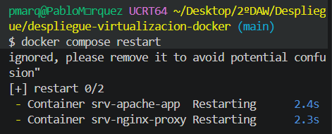
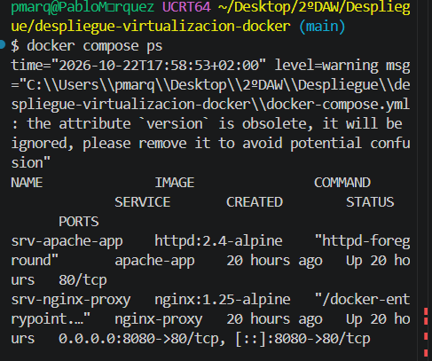
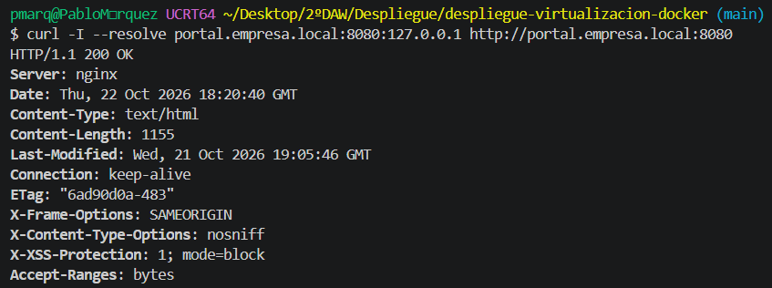
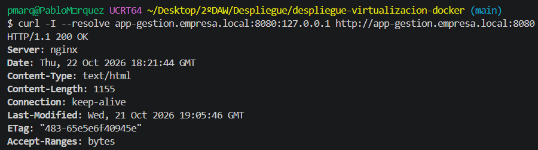
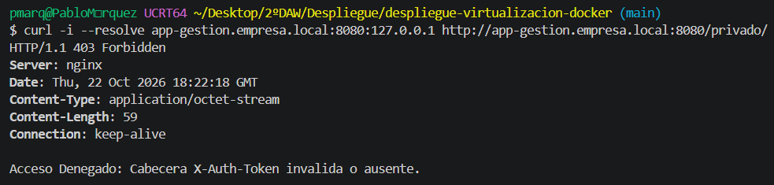
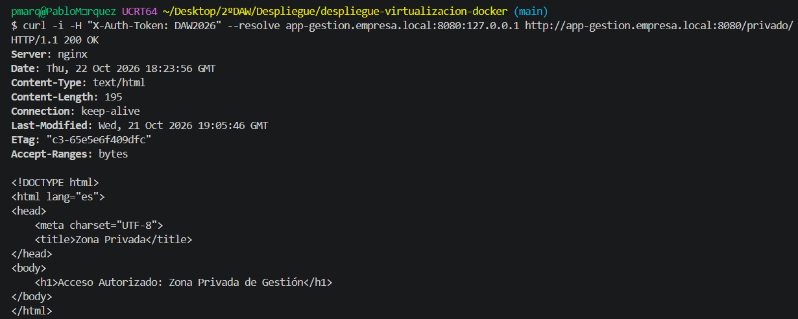

# **Despliegue de Infraestructura Web Segura (Nginx + Apache )**

Este proyecto implementa una arquitectura web desacoplada en **Docker Compose** compuesta por un **proxy inverso** (**Nginx**) y un **servidor de aplicaciones** (**Apache**), asegurando la segregación de tráfico, el *hardening* (endurecimiento de sistemas) mediante cabeceras HTTP de seguridad y el cumplimiento de la normativa de protección de datos (**RGPD**).

## Arquitectura del Sistema

En primer lugar, siguiendo el principio de **Infraestructura como Código (IaC)**, he iniciado una estructura de directorios limpia, desacoplada y versionable.

* **Cliente / Navegador:** Accede a través de los dominios locales mapeados en el puerto 8080 (**portal.empresa.local:8080** y **app-gestion.empresa.local:8080**).  
* **srv-nginx-proxy (Nginx):** Funciona como punto de **entrada único** (Proxy Inverso) expuesto en el puerto 8080 del host.  
* **srv-apache-app (Apache):** Servidor backend aislado que **procesa las peticiones** de la aplicación.  
* **Red Interna (red-corp):** Comunicación **privada** e interna entre **Nginx** y **Apache** a través del puerto 80\.

## Medidas de Hardening y Cumplimiento RGPD (default.conf) 

1. **Aislamiento de Red:** El servidor **Apache** backend (**srv-apache-app**) no expone ningún puerto hacia el **host público**, siendo únicamente accesible de forma interna por el proxy **Nginx** a través de la red red-corp.

2. **Inyección de Cabeceras de Seguridad:** **Nginx** fuerza las siguientes cabeceras **HTTP** en todas las respuestas:  
   * **X-Frame-Options: SAMEORIGIN** (Protección contra Clickjacking).  
   * **X-Content-Type-Options: nosniff** (Mitigación de ataques de MIME sniffing).  
   * **X-XSS-Protection: 1; mode=block** (Protección activa contra scripts XSS).

3. **Control de Acceso por Token:** El endpoint sensible **/privado/** en el dominio app-gestion.empresa.local requiere la cabecera HTTP **X-Auth-Token: DAW2026**. Cualquier solicitud sin esta cabecera es rechazada automáticamente con un código **403 Forbidden**, queriendo decir que no tiene permiso para entrar.
  
4. **Segregación y Privacidad de Logs (RGPD):**  
   * Se gestiona el registro de auditoría de **acceso** y **errores** de manera **independiente** por dominio (portal\_access.log, app\_gestion\_access.log).  
   * Los registros de tráfico y archivos de proceso local (**\*.log, \*.pid**) están expresamente excluidos del control de versiones mediante **reglas estrictas** en **.gitignore**, preservando la estructura de directorios en Git mediante ficheros .**gitkeep**.

## Despliegue y Verificación

### Requisitos Previos

Antes de desplegar mada, hay que configurar las entradas DNS locales en el archivo de hosts del sistema operativo. En este caso, al trabajar con Windows, la ruta absoluta sería la siguiente:  
**C:\\Windows\\System32\\drivers\\etc\\hosts o /etc/hosts**. Dentro de ella, añadimos en dicho archivo lo siguiente: **127.0.0.1 portal.empresa.local app-gestion.empresa.local**. Una vez hecho esto, ya podemos desplegar la infraestructura de contenedores adecuadamente.

### Comandos de Despliegue

Primero, para levantar la infraestructura de contenedores en segundo plano, ejecutamos en la consola lo siguiente:
**docker compose up \-d**
Al tener que realizar el requisito previo y cambiar el host, tuve que eecutar el siguiente comando para que se actualizará:
**docker compose restart**

Luego, comprobamos el estado del ciclo de vida y los puertos asignados con este comando:
**docker compose ps**
*(Salida esperada:* srv-nginx-proxy mostrará 0.0.0.0:8080-\>80/tcp, mientras que srv-apache-app mostrará 80/tcp sin mapeo hacia el host.)

### Comandos de Verificación (curl)

1. **Portal Estático:** 
**curl \-I http\://portal.empresa.local:8080**
(Salida esperada: HTTP/1.1 200 OK)

2. **Aplicación de Gestión:** 
**curl \-I http\://app-gestion.empresa.local:8080**
(Respuesta esperada: HTTP/1.1 200 OK)

3. **Validación de Bloqueo en /privado/ (Sin Token):** 
**curl \-i http\://app-gestion.empresa.local:8080/privado/**
(Respuesta esperada: HTTP/1.1 403 Forbidden)

4. **Validación de Acceso Autorizado en /privado/ (Con Token):** 
**curl \-i \-H "X-Auth-Token: DAW2026" http\://app-gestion.empresa.local:8080/privado/**
(Respuesta esperada: HTTP/1.1 200 OK)

He utilizado **--resolve** porque Git Bash no consulta el archivo hosts de Windows directamente, por lo que este parámetro le indica a curl la IP exacta (127.0.0.1) a la que debe enviar la petición para ese dominio sin depender de la DNS del sistema.